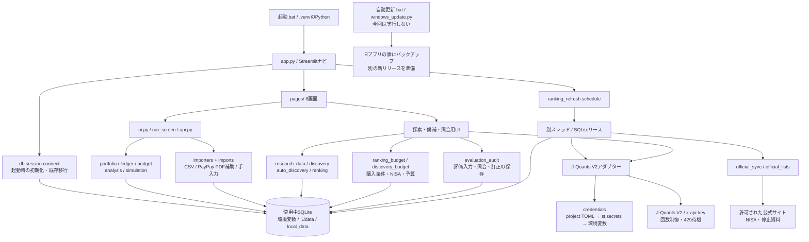
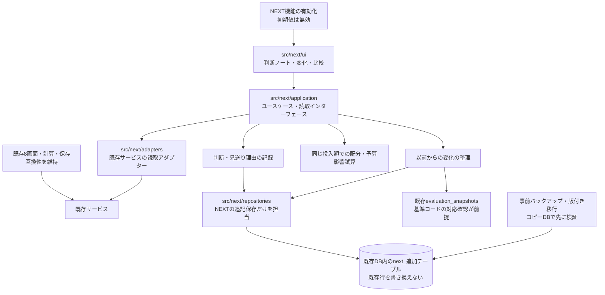

# システム構成図

## 現行（クラウドの基準コード）

`simulation.py` の計算自体はDBに依存しません。画面が既存残高を読み、純粋な計算関数へ渡します。図のCore→DBはグループ全体の保存・参照関係を示します。

APIへ口座残高や照合メモを送る構成ではありません。キーは認証ヘッダー用にメモリーへ読み込み、図や報告書へ値を出しません。

## NEXTの追加案（今回未実装）

J-Quants接続・APIキー参照・レート制御は既存処理を再利用し、NEXT用の別クライアントで重複取得を増やしません。既存サービスへの書込権限を与えずに始め、必要な変更を個別にレビューします。
